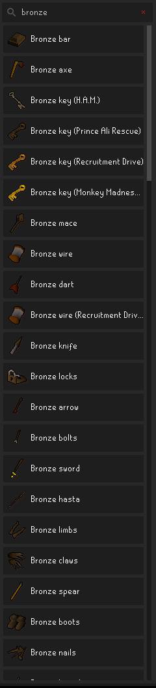
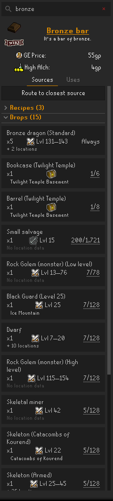
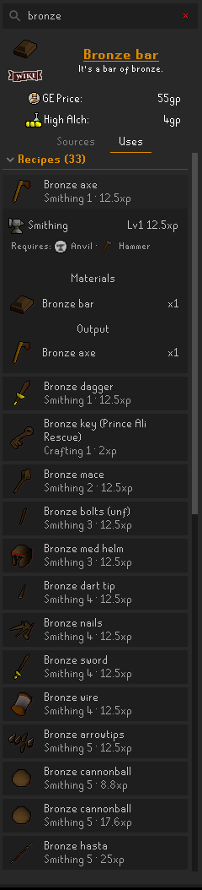

# Item Atlas

Where to get every item in Old School RuneScape and what it's used for: shops, drops, ground spawns, recipes and uses, sourced from the OSRS Wiki.

  
  
  

Item Atlas is a fork of [Not Enough Runes](https://github.com/Hannah-GBS/notenoughrunes) by Hannah_GBS and LlemonDuck (BSD 2-Clause, see [LICENSE](LICENSE)).

Item data comes from [Ku-Tadao/runelite-wiki-scraper](https://github.com/Ku-Tadao/runelite-wiki-scraper), a fork of Hannah_GBS's scraper that rebuilds `data.sqlite` from the OSRS Wiki every Friday.

## What it shows

Search for an item in the side panel, or look one up by right-clicking it in your inventory, equipment, bank or collection log.

**Sources** lists every way to get the item:

- **Recipes**: the skill, level, experience, tools and facility, and the materials that go in.
- **Drops**: each monster or object that drops it, merged into one row per source with its combat level, quantity, best drop rate and the locations the wiki lists.
- **Shops**: stock and price, per shop.
- **Ground spawns**: where the item lies on the ground.

**Uses** lists the recipes the item goes into, 50 at a time with a **Load more** button, and the shops that take it as currency. Recipe cards stay collapsed to one line until you open one.

Each section header shows how many entries it has. Sections appear as their data loads, so a busy item doesn't hold up the panel.

## Keys and locked chests

Some drop sources need an item before you can loot them, like a chest's key. Item Atlas tracks where you keep it and colours the drop row by its key status: carried, in the bank, in group storage, or not owned. A source whose key you don't have anywhere is skipped when routing.

## Routing to sources

Right-click a shop, spawn or drop location, or use **Route to closest source** on an item's sources, to get directions. Item Atlas works with whichever route plugin you have enabled:

- **GPS**, if it's enabled (preferred, sent on GPS's own channel so it never routes twice)
- **Shortest Path** otherwise

**Route to closest source** covers shops, every ground-spawn tile, and the locations of monsters and objects that drop the item (toggle each in the config). **Route best drop rate** limits drop routing to the sources with the best rate. The button's tooltip lists what the route needs, such as a key, a quest or a diary.

Routes don't guarantee shop stock, ground-item availability, drop rates or access requirements. Recipes are not included.

## Config

| Option | What it does |
| --- | --- |
| Inventory / Equipment / Bank / CLog Lookup | Adds a right-click lookup to items in each place |
| Chat Broadcast Lookups | Adds a lookup to clan chat loot drop broadcasts |
| Default Open Sources / Uses | Which sections start open (a section you open or close stays that way) |
| Members star | Marks members-only shops, spawns and drop locations with a star. Off by default |
| Route shops / ground spawns / drop sources | What **Route to closest source** includes |
| Route best drop rate | Only route to the drop sources with the best rate |
| Better Monster Examine | Click a monster in the Drops section to look it up in Better Monster Examine (needs that plugin) |

## Quest Helper integration

Quest Helper's item lookups still reach Item Atlas, since it keeps listening on Not Enough Runes' message channel.
